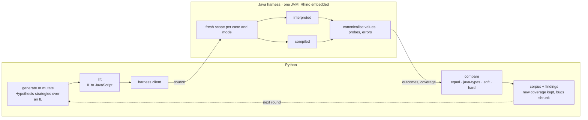

# oxpecker

Differential testing of [Mozilla Rhino](https://github.com/mozilla/rhino). Rhino runs JavaScript
two ways: an **interpreter**, and a **compiler** that emits JVM bytecode. The two should agree on
every program. oxpecker generates programs, runs each one both ways in one JVM, canonicalises what
came out, and treats any difference as a bug candidate. The
[findings so far](docs/findings-explained.md) range from `-0` lost in compiled arithmetic to
`super` references that crash the compiler.



## Install

JDK 21 and Python 3.13.

```bash
(cd harness-java && ./gradlew fatJar)              # harness jar, bundles Rhino 1.9.2 from Maven Central
python3.13 -m venv .venv && .venv/bin/pip install -e '.[dev]'
source .venv/bin/activate
```

The Rhino version is `rhinoVersion` in `harness-java/gradle.properties`; a locally published
snapshot works as well.

## First run

Generate a handful of programs and read them:

```bash
oxpecker gen -n 10 -o runs/first --seed 1
```

Each case is written three ways: `case_0003.js` with `__probe` snapshots and a `// [generator]`
marker per statement, `case_0003.plain.js` without them, and `case_0003.il`, the intermediate form
it was built in. A plain one looks like this:

```js
var arr0 = [];
let n2 = 0x6708;
for (let i4 in arr0) {
    let n7 = -1000.0;
    arr0[0] = "µ¹z";
}
var n10 = 33;
var o11 = new BigUint64Array(n10);
function f18(p19, p20, p21, p22) {
    arr0[p21] /= n10;
    return arr0;
}
for (let i26 = 0; i26 < 100; i26++) {
    let arr33 = f18(f18, [4, 7, 10, 5], o11, "function");
}
```

Run them through both modes and see the verdicts:

```bash
oxpecker gen -n 50 -o runs/first --seed 1 --run
```

```
  1  java-types:diff Double,Double,Double vs Integer,Integer,Integer
  interpreted  ok=15, throw=5
  compiled     ok=14, throw=5, unsupported=1
```

Most programs agree. `java-types` means the JavaScript behaviour was identical and only the Java
class of a number differed at the probe (the interpreter hands Java a `Double`, compiled code an
`Integer`), which matters to embedders and is recorded, not failed on. A **hard** verdict is a
real difference: a value, a thrown error, or a crash in one mode.

Look at one file and see exactly where the modes part:

```bash
oxpecker diff tests/regressions/compiled-top-level-multiply-by-zero-loses-sign.js
```

```
verdict: HARD: trace[0] arg1 true vs false
trace[0]: first difference at char 9
  interpreted  …"step" | ▶true | -Infinity | true…
  compiled     …"step" | ▶false | Infinity | false…
```

That file is three lines: `var x = -3; var y = x * 0;` and a probe of `Object.is(y, -0)`. Compiled
code types `x` as an int and loses the sign of zero.

## Let it search

```bash
oxpecker fuzz -o runs/c1 --seconds 600
```

This is the loop in the diagram. It keeps a corpus of programs that each reached Rhino code
nothing before them had (JaCoCo probes over Rhino's classes), extends a corpus entry by a few
mutation steps or draws a fresh program, runs it, and keeps it if it covered something new. A hard
verdict with a signature no regression already has is shrunk, first at the IL level by
Hypothesis, then statement by statement on the source, and written to `tests/findings/` as a
small reproducer. The corpus and coverage persist in `-o`, so a second run continues.

An hour runs about seven thousand programs and has so far turned up one new Rhino bug per
campaign; the numbers are in
[the findings doc, section 7](docs/findings-explained.md#7-the-hour-long-campaigns).

## The IL underneath

Programs are not built as text. Generators and mutators are
[Hypothesis](https://hypothesis.readthedocs.io/) strategies over a small typed intermediate
language in the style of [Fuzzilli](https://github.com/googleprojectzero/fuzzilli)'s FuzzIL;
a lifter turns it into JavaScript at the end. The `.il` file next to each case shows it:

```
v0 <- CreateArray(num_elements=0)
v2 <- LoadInteger(value=26376, radix=<Radix.HEX: 16>)
BeginForEachLoop(kind=<ForEachKind.IN: 'in'>, declaration=<DeclarationKind.LET: 'let'>) v0 -> v4, v5
    v6 <- LoadFloat(value=1000.0, style=<FloatStyle.PLAIN: 'plain'>)
    v7 <- UnaryOperation(op=<UnaryOperator.MINUS: 'minus'>) v6
    SetElement(index=0) v0, v1
EndForEachLoop()
```

Because mutation happens on the generator's choices rather than on JavaScript text, every
mutant is a valid program, and Hypothesis's shrinker works on findings for free. A program's
whole history is a choice sequence, which is what the corpus stores.

To play with the pieces from a Python shell (generate, print the IL, lift, analyse, mutate, run in
Rhino), follow [`docs/repl-tutorial.md`](docs/repl-tutorial.md). `oxpecker gen --evolve 4` writes
cases that are the end of a four-step mutation lineage; `oxpecker list` prints the generators.

## Reading on

- [`docs/design.md`](docs/design.md): the harness, the comparison rules, the corpora, what is in scope.
- [`docs/design-generation-layer.md`](docs/design-generation-layer.md) and
  [`docs/implementation-generation-layer.md`](docs/implementation-generation-layer.md): the IL,
  generators, mutators and the loop, as designed and as built.
- [`docs/findings-explained.md`](docs/findings-explained.md): every finding by root cause, with
  which mode is right; [`docs/upstream-crosscheck.md`](docs/upstream-crosscheck.md) has what Rhino
  already knows about each.
- [`docs/glossary.md`](docs/glossary.md): the words used above and in the code.
- `oxpecker --help`: the other commands (replaying test262 and Rhino's own suites, coverage,
  the capability probe, the inspector export).

## Findings

Every confirmed bug is a file under `tests/regressions/` with a header that says what both modes
do and which is right; `oxpecker diff <file>` replays it, and the test suite checks it stays
detected. The seven under `master-only/` show on Rhino master `b95f75d` but not on the 1.9.2
release.

## Tests

```bash
pytest                        # about three minutes; needs the harness jar
pytest tests/il               # the generation layer alone, mostly without a JVM
```
